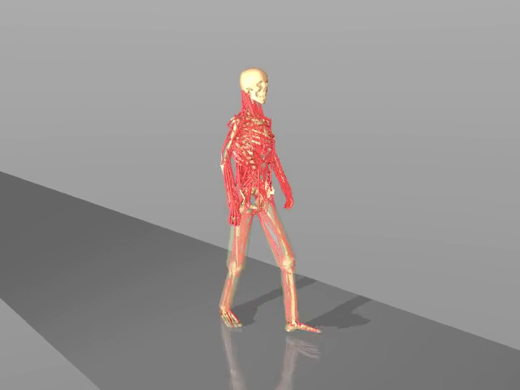

# 人体肌骨仿真与 ROS 2 外骨骼控制

**可运行分享版｜MuJoCo · MyoAssist · ROS 2 Humble · MS-Human-700**

本仓库提供两条可独立运行的仿真路线，以及对应的配置、状态记录和测试程序：

| 路线 | 模型与控制方式 | 可以运行什么 |
|---|---|---|
| **A：ROS 2 外骨骼控制** | MyoAssist `myolegs22 + DephyExoBoot_L1`；22 肌肉 + 2 外骨骼执行器 | 实时窗口、TCP 客户端、ROS 2 指令与反馈、左右短时控制、三组动力学对照 |
| **B：肌肉驱动行走复现** | MS-Human-700 + 官方 msgym / DynSyn-SAC | 700 肌肉全身与 100 肌肉下肢行走短回合、窗口、录像和原始状态记录 |

**ROS 2 控制目前对应路线 A。路线 B 尚未接入 ROS 2，两条路线使用不同模型与独立 Python 环境。** 模型和策略从官方渠道安装/下载，运行所需代码与配置随本仓库提供。



## 快速启动 ROS 2 控制仿真

推荐 Ubuntu 22.04，已安装 ROS 2 Humble。所有终端先进入本仓库根目录。

首次安装仿真环境（需要 `uv`；具体前置条件见安装说明）：

```bash
bash scripts/setup_sim.sh
```

然后分别在三个终端执行：

```bash
# 终端 1：唯一的仿真实例 + MuJoCo 实时窗口
bash scripts/start_sim.sh
```

```bash
# 终端 2：ROS 2 与 TCP 桥接；不创建第二个人体模型
bash scripts/start_bridge.sh
```

```bash
# 终端 3：复位 → 关闭 → 右侧 −5 N·m → 关闭 → 左侧 −5 N·m → 关闭
bash scripts/run_ros_demo.sh
```

应看到同一窗口里的设备输出和仿真时间变化，终端打印 `Demo passed`，并生成 CSV、JSONL 和 PNG。每阶段只推进一个控制步，随后暂停供观察；此演示验证控制和反馈链路，不提供稳定行走控制器。

- [完整安装与三终端使用说明](docs/ROS2_SIMULATION.md)
- [TCP / ROS 接口、单位及安全关闭](docs/CONTROL_INTERFACE.md)
- [三组短时动力学对照与自动测试](docs/TESTING.md)

## 打开 MS-Human-700 行走窗口

先按 [MS-Human-700 运行说明](docs/RUNNING.md) 准备官方源码、检查点和独立 Python 3.12 环境。完成后执行：

```bash
OPENBLAS_NUM_THREADS=1 OMP_NUM_THREADS=1 MUJOCO_GL=glfw \
  .venv_ms700/bin/python scripts/run_ms700.py \
  --model full --seconds 10 --seed 0 --window
```

该指令使用真实 Actor 推理与肌肉动力学，默认官方三周期约 **3.52 s** 后结束。`--seconds 10` 是运行上限。下肢版本使用 `--model legs`。

## 当前实测边界

| 项目 | 已验证结果 | 边界 |
|---|---|---|
| ROS 2—TCP—MuJoCo | 真实左右控制、限幅、超时关闭、同实例窗口及反馈核对 | 非稳定步行或助力有效性验收 |
| MS-Human-700 全身 / 下肢 | 两者均完成 3.52 s；分别前进 3.314 / 3.578 m | 长时上限测试分别在 3.64 / 3.88 s 跟踪误差终止 |
| MyoSuite 80 肌肉基线 | 既有试验完成 30 s、约 43.52 m | 存在漂移与膝不对称；本包提供概述，不含此模块运行器 |
| V1 短时预测 | 已建立保持状态、常速度、GRU 评价流程 | 数据含异常步态；本包不分发预测数据和权重 |

短回合完成不能作为健康步态或长时稳定行走的结论。见 [代表性结果与图表说明](docs/RESULTS.md)、[本分享版验证记录](docs/SHARE_VALIDATION.md)。

## 目录与后续协作

```text
scripts/              安装检查、三终端启动脚本、MS-Human-700 运行器
tools/                TCP 服务/客户端、ROS 桥接/演示、对照实验与测试
myoassist_utils/      模型组合运行时代码
rl_train/             MyoAssistLegBase 及其必要配置、工具（运行时子集）
docs/                 安装、接口、验证和结果说明
assets/               展示图与代表性短回合录像
results/              精选结果摘要、版本与源码哈希
pyproject.toml        MyoAssist Python 3.11 运行依赖与兼容覆盖
requirements-ms700.txt MS-Human-700 Python 3.12 环境版本
```

没有包含全部训练框架、研究数据和实验室样机设计文件。自研髋关节样机尚未完成联合模型验收，不能只换配置名称就视为已接入。开源模型、算法及数据来源、分享范围见 [SCOPE_AND_SOURCES.md](docs/SCOPE_AND_SOURCES.md)。
