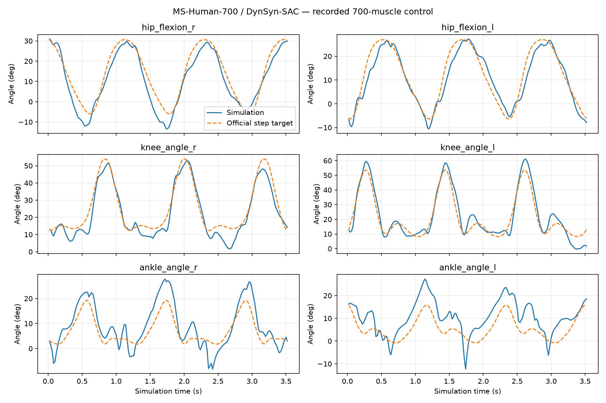

# 代表性结果与解读

## MS-Human-700 实验

实验日期为 2026-11-09。本分享重新整理已有记录，并测试分享版运行脚本；没有重新训练策略。完整精度摘要见 [ms700_summary.json](../results/ms700_summary.json)。

- 全身：700 肌肉，3601 维观测，85 个 qpos / qvel 坐标。
- 下肢：100 肌肉，748 维观测，36 个 qpos / qvel 坐标。
- 两者均为 2 ms 物理积分、20 ms 控制周期；固定 seed 0、确定性动作。
- 采用对应官方策略和观测归一化文件；禁用参考回放和回合自动重置。
- 默认三周期实际运行 176 个控制步、3.52 s。全身最低骨盆高度 0.876 m，下肢 0.862 m。
- 全身窗口、录像与无窗口基线的 qpos/qvel/act/ctrl/Actor 输出逐元素一致。该结论只对应本机已记录条件，不保证不同软件和硬件逐位一致。

## 六关节图怎么看

每个子图对应一侧的髋、膝或踝。左列为右腿，右列为左腿；从上到下依次是髋、膝、踝。横轴是仿真时间（s），纵轴是关节角（°）。橙色虚线为此模型的官方当步参考目标，蓝色实线为肌肉驱动物理仿真的实际结果。

两条线接近说明该关节在此时段跟踪较好。例如右髋的全回合 RMSE 为 4.592°，左踝为 6.486°，提示左踝值得继续检查。它们不是与独立健康人数据的误差，也不能单凭曲线接近认定步态健康。

| 关节 | 右侧 RMSE / ° | 左侧 RMSE / ° |
|---|---:|---:|
| 髋屈伸 | 4.592 | 3.804 |
| 膝屈伸 | 4.854 | 4.829 |
| 踝 | 4.929 | 6.486 |

## 为什么不写“已稳定走 30 秒”

只提高周期上限、保留原始终止条件后，全身在 3.64 s、下肢在 3.88 s 触发跟踪误差终止。原判据平均了多种坐标，不等同于六关节角度 RMSE，也不是骨盆触地判据。因此准确表述是“长时测试未通过”，不能直接把该终止解释为已经跌倒，更不能删掉终止条件后宣称稳定。

当前展示录像为全身短回合：640×480、30 fps、106 帧；视频时长约 3.533 s，物理时间 3.520 s，差异来自帧率采样。

## 其他阶段工作

这些内容在本分享中提供概览，不附完整实现、原始数据或权重：

- MyoSuite 80 肌肉基线曾完成 30 s、前进约 43.52 m，但明显侧移、右膝活动不足；保留为异常运动对照。
- V1 预测已完成 37 回合、31,078 帧的数据流程与三种预测基线。由于来源步态异常，不将其称为健康人预测模型。
- MuscleMimic 1.0.6 官方 single-clip 策略已进行真实推理与重复性诊断；4.84 s 片段完成不等于持续行走，膝约束、踝误差和刺激饱和仍需区分原因。
- ROS 2—TCP—MuJoCo 接口及外骨骼左右通道对照已验证；还没有证明降低代谢消耗或改善步态。

## 下一步验收

1. 固定模型、策略、参考、动作映射与软件版本，保持同条件重复性。
2. 分开检查参考约束、跟踪误差、足接触、滑移及左右周期协调，不以单个误差指标替代正常性评价。
3. 延长测试时保留失败数据、原终止条件和真实物理时间。
4. 健康参考完成单位、零位、方向、速度与周期对齐后，再给出跨模型误差。

本仓库未复现 QFlex 或文章中的 GPU 高保真运动跟踪，也未开展新的控制器训练。

## 分享脚本检查

2026-11-11 在既有兼容环境中，分别运行全身和下肢 10 个控制步（0.20 s）。两者均真实调用 Actor 10 次，qpos/qvel/ctrl/act/Actor 输出与既有基线的对应前缀最大绝对差均为 0。见 [分享检查记录](../results/share_validation.json)。本次没有重复安装环境或重测桌面窗口；窗口与视频结论来自上述已有实验。
