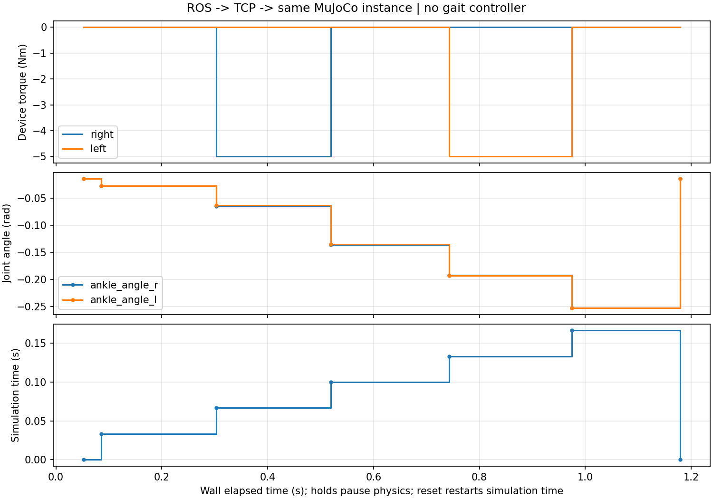

# ROS 2 控制 MyoAssist：安装与运行

## 1. 环境分工

| 进程 | Python | 作用 |
|---|---|---|
| TCP 服务 / MuJoCo | 仓库独立 `.my_venv`，3.11 | 加载人体＋Dephy，独占唯一环境，推进物理、渲染窗口 |
| ROS 2 桥接 / 控制演示 | `/usr/bin/python3`，Humble 系统 Python 3.10 | ROS 话题收发与 TCP 中转，不创建模型 |
| MS-Human-700 | 独立 `.venv_ms700`，3.12 | 另一条官方策略复现路线；不与本节环境混用 |

支持基线为 Ubuntu 22.04 + ROS 2 Humble。图形窗口需要可用的桌面 OpenGL。不要用 sudo 启动仿真，也不要把 rclpy 安装进 Python 3.11 环境。

## 2. 首次安装

进入下载/克隆后的仓库根目录。先确认系统 ROS 可用：

```bash
source /opt/ros/humble/setup.bash
/usr/bin/python3 -c 'import rclpy; from std_msgs.msg import String; print("ROS imports OK")'
/usr/bin/python3 -c 'import numpy, matplotlib; print("Plotting imports OK")'
```

若缺少系统绘图库，Ubuntu 可安装 `python3-numpy`、`python3-matplotlib`。若缺少 ROS 2，先按 [ROS 官方 Humble Ubuntu 安装说明](https://docs.ros.org/en/humble/Installation/Ubuntu-Install-Debs.html) 安装；本仓库不自动修改系统 ROS。

仿真环境使用 uv。没有 uv 时可按 [官方安装说明](https://docs.astral.sh/uv/getting-started/installation/) 准备，例如已有 pip 的系统可执行 `python3 -m pip install --user uv`，再重新打开终端并确认 `uv --version`。

```bash
bash scripts/setup_sim.sh
```

脚本在**本仓库**创建 Python 3.11 `.my_venv`，安装项目及固定依赖，并检查导入路径。Myosuite 2.8.4 的包元数据锁定旧 MuJoCo / dm-control，但组合模型需要 MuJoCo 3.4；本仓库沿用 MyoAssist 的兼容覆盖 `mujoco==3.4.0`、`dm-control==1.0.36`。因此请用所给 uv 安装流程，不用普通 pip 直接解析这一组合，也不为消除旧元数据冲突而降级 MuJoCo。

模型文件随 `myo-sim==0.2.3`、`assist-sim==1.0.0` 安装；不需要从原开发者电脑复制虚拟环境或填写个人模型路径。组合代码、环境基类及配置已包含在仓库内。安装依赖需要联网；如果固定版本无法下载，保留具体错误，不随意替换版本。

只检查环境：

```bash
.my_venv/bin/python -m scripts.check_environment sim
source /opt/ros/humble/setup.bash
/usr/bin/python3 -m scripts.check_environment ros
```

## 3. 三终端启动（先后顺序）

每个终端都必须进入**同一个分享仓库根目录**。

终端 1：

```bash
bash scripts/start_sim.sh --port 8765
```

应弹出人体＋踝关节外骨骼窗口，终端打印 `listening`。初始状态为 `reset_required`，没有控制命令不会推进物理。

终端 2：

```bash
bash scripts/start_bridge.sh --port 8765
```

脚本自动 source Humble，使用系统 Python，设置 `ROS_LOCALHOST_ONLY=1`、默认 `ROS_DOMAIN_ID=42`。

终端 3：

```bash
bash scripts/run_ros_demo.sh --cycles 3 --hold 1.5
```

每回合依次复位、两侧关闭、右侧 −5 N·m、关闭、左侧 −5 N·m、关闭。每个控制阶段推进 1/30 s；`--hold` 是暂停观察的墙钟时间，不是持续施加力矩积分。三回合积分合计约 0.5 s。没有行走控制器时，人体短时运动或失稳不代表通信失效。

终端打印 `Demo passed`，右侧与左侧阶段的实际设备力矩分别为约 `[-5,0]` 与 `[0,-5]`；关闭阶段为 `[0,0]`。窗口实例、实际输出与 ROS 状态一致，才是本演示成功标准。

## 4. 查看实时反馈

另开同目录终端：

```bash
source /opt/ros/humble/setup.bash
export ROS_LOCALHOST_ONLY=1 ROS_DOMAIN_ID=42
ros2 topic echo /myoassist/state
```

若更换域号，需在桥接、演示和查看反馈的所有 ROS 终端都设置相同 `ROS_DOMAIN_ID`。不要同时运行两个桥接进程争用同一 TCP 连接。

默认输出：`results/ros_live_server.jsonl`、`results/ros_live_demo.jsonl`、`results/ros_live_demo.csv`、`results/ros_live_demo.png`。演示重复运行会覆盖默认演示文件，可通过 `--output results/demo_02` 改前缀；服务日志追加。

## 5. 演示图与数据



上图来自分享目录的真实 ROS 演示。横轴是分阶段观察的墙钟时间；每阶段仅推进一个物理控制步，因此不要把墙钟停留时间当成持续积分时间。上下曲线依次反映设备输出、踝角度与仿真时间，以实际图例为准。读数成功不等于已证明助力有益。

## 6. 不使用 ROS，直接测试 TCP

先停掉桥接进程，再运行客户端，因为服务只允许一个活动控制连接：

```bash
# 终端 1：可保留窗口；无窗口时使用此命令
bash scripts/start_sim.sh --no-window --port 8765
```

```bash
# 终端 2：普通 Python 标准库客户端
/usr/bin/python3 -m tools.exo_tcp_client ping --port 8765
/usr/bin/python3 -m tools.exo_tcp_client demo --port 8765
```

CLI demo 会在同一个连接中复位、关闭、右侧短时输入、左侧短时输入、关闭；读取的是实际 MuJoCo ctrl 和输出。CLI step 会自行先复位。

## 7. 停止和常见问题

- 在服务窗口关闭，或服务终端 Ctrl+C：设备关闭，服务退出。
- 桥接 Ctrl+C / TCP 断线：服务端关闭设备，后续必须显式 reset。
- 看门狗超时：实际外骨骼 ctrl 归零，旧 epoch 失效；需要新 reset。窗口启动器为观察设置 10 s 看门狗。
- `No module named tools`：当前不在分享仓库根目录；先切换目录，不必安装新模块。
- 窗口显示失败：检查桌面 DISPLAY / OpenGL；可先无窗口验证，不把无窗口结果记作渲染通过。
- `Address already in use`：停掉旧服务，或给服务与桥接同时指定另一端口。
- 模型加载或关节名验证失败：检查安装包版本与默认配置，勿复制其他模型的索引修补。

安全映射、原始 JSON 格式和状态字段见 [CONTROL_INTERFACE.md](CONTROL_INTERFACE.md)。
